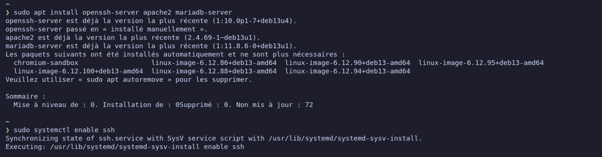
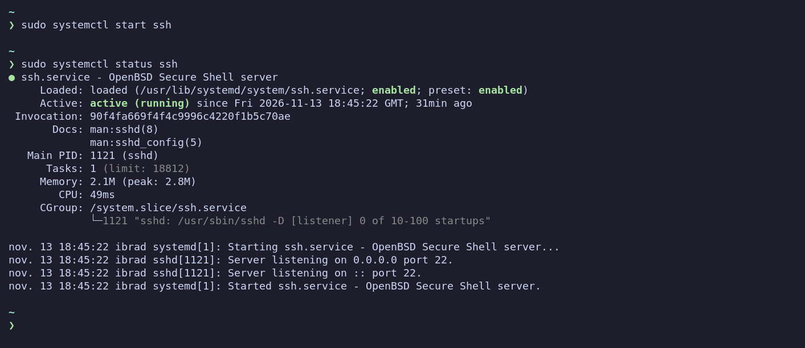
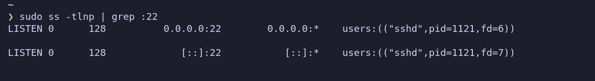
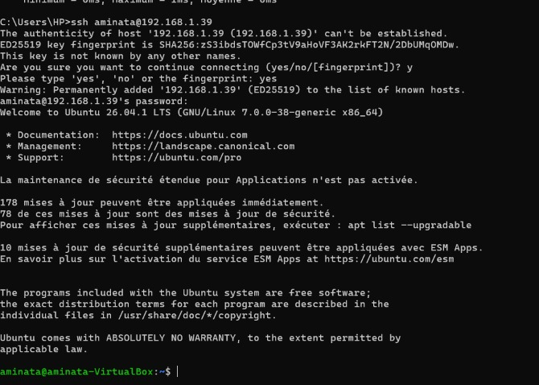
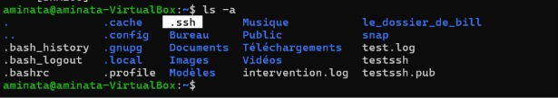
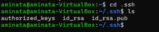
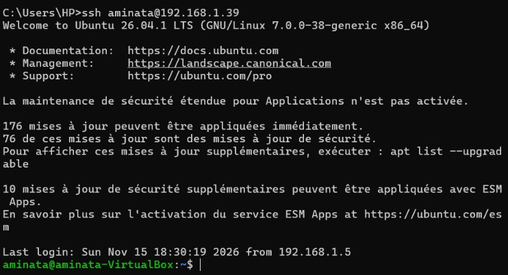
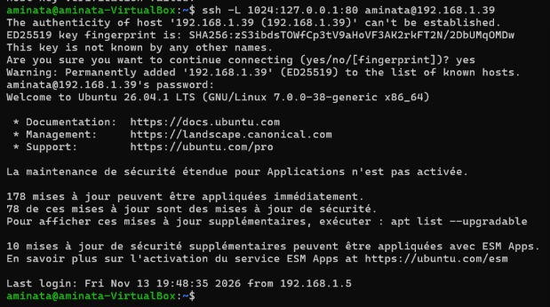
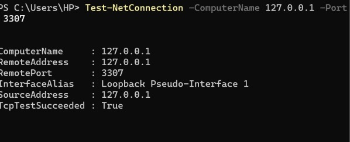

# TP 1 : Mise en place du protocole SSH

**DGI-ESP / UCAD · L3 GLSI · 2026-2027 · Services Réseaux Avancés**

| | |
|---|---|
| **Binôme** | El Hadji Ibra Diagne et Aminata Gueye |
| **Enseignant** | Dr Gueye |

## Sommaire

1. [Introduction](#1-introduction)
2. [Organisation](#2-organisation)
3. [Installation du serveur SSH](#3-installation-du-serveur-ssh)
4. [Connexion depuis le client](#4-connexion-depuis-le-client)
5. [Clés SSH](#5-clés-ssh)
6. [Tunnel SSH](#6-tunnel-ssh)
7. [Difficultés](#7-difficultés)
8. [Conclusion](#8-conclusion)

---

## 1. Introduction

SSH permet de se connecter à une machine à distance de façon sécurisée : tout ce qui passe entre les deux machines est chiffré. Le serveur attend les connexions sur le **port 22** et le client vient s'y connecter.

## 2. Organisation

Nous avons utilisé trois machines :

| Machine | Système | Adresse IP | Utilisée pour |
|---|---|---|---|
| PC d'Ibra | Debian 13 | — | Installation et vérification du service SSH (étape 3) |
| VM d'Aminata (VirtualBox) | Ubuntu 26.04 | `192.168.1.39` | **Serveur** pour les étapes 4 à 6 |
| PC d'Aminata | Windows | `192.168.1.5` | **Client** pour les étapes 4 à 6 |

Nous avons commencé sur le PC d'Ibra. Comme nos deux PC n'étaient pas sur le même réseau Wi-Fi, nous avons fait les connexions entre les deux machines d'Aminata, qui étaient sur le même réseau.

## 3. Installation du serveur SSH

*Captures prises sur le PC d'Ibra (Debian 13).*

```bash
sudo apt install openssh-server apache2 mariadb-server
sudo systemctl enable ssh
sudo systemctl start ssh
```

- **Apache2** et **MariaDB** servent pour les tunnels de l'[étape 6](#6-tunnel-ssh).
- `enable` lance SSH à chaque démarrage, `start` le lance tout de suite.


*Capture 1 : installation des paquets (PC d'Ibra)*


*Capture 2 : le service SSH est actif et écoute sur le port 22 (PC d'Ibra)*

La commande `ss` confirme que le port 22 est ouvert et utilisé par `sshd` :

```bash
sudo ss -tlnp | grep :22
```


*Capture 3 : le port 22 est ouvert (PC d'Ibra)*

Les mêmes paquets ont été installés sur la VM Ubuntu d'Aminata, qui sert de serveur pour la suite du TP.

## 4. Connexion depuis le client

*Commande lancée depuis le client Windows vers le serveur Ubuntu.*

```bash
ssh aminata@192.168.1.39
```

À la première connexion, SSH affiche l'empreinte du serveur. Après `yes`, elle est enregistrée dans `known_hosts`, ce qui permet de reconnaître le serveur la fois suivante. Après le mot de passe, nous sommes sur le terminal du serveur.


*Capture 4 : connexion du client Windows au serveur Ubuntu*

## 5. Clés SSH

Une paire de clés remplace le mot de passe :

- la **clé privée** (`id_rsa`) reste sur la machine qui l'a créée ;
- la **clé publique** (`id_rsa.pub`) est copiée dans le fichier `authorized_keys` de la machine à laquelle on veut se connecter, ici le serveur.

La paire de clés se crée avec :

```bash
ssh-keygen -t rsa
```

Les clés sont rangées dans le dossier caché `.ssh` du dossier personnel. Les captures 5 et 6 montrent ce dossier sur le serveur Ubuntu.


*Capture 5 : le dossier caché `.ssh` (serveur Ubuntu)*


*Capture 6 : clés et fichier `authorized_keys` dans `.ssh` (serveur Ubuntu)*

**Test final :** une fois la clé publique du client placée dans le fichier `authorized_keys` du serveur, nous nous sommes reconnectés depuis le client Windows. Le serveur n'a plus demandé de mot de passe : la connexion se fait directement avec la clé.

```bash
ssh aminata@192.168.1.39
```


*Capture 7 : connexion du client Windows par clé, aucun mot de passe demandé*

## 6. Tunnel SSH

Un tunnel fait passer un autre service à travers la connexion SSH chiffrée. La commande `ssh -L port_local:127.0.0.1:port_distant` relie un port de la machine qui lance la commande à un port du serveur.

### Tunnel vers le serveur web (Apache)

*Commande lancée depuis le serveur Ubuntu lui-même, pour vérifier le principe.*

```bash
ssh -L 1024:127.0.0.1:80 aminata@192.168.1.39
```

Le port `1024` de la machine qui lance la commande est relié au port `80` (Apache) du serveur. L'adresse `http://localhost:1024` affiche alors le site Apache du serveur. Comme cette connexion partait de la VM vers elle-même, SSH a de nouveau demandé de confirmer l'empreinte et le mot de passe.


*Capture 8 : tunnel vers le serveur web, lancé depuis le serveur Ubuntu*

### Tunnel vers la base de données (MariaDB)

*Commande lancée depuis le client Windows.*

```bash
ssh -L 3307:127.0.0.1:3306 aminata@192.168.1.39
```

Le port `3307` du client est relié au port `3306` (MariaDB) du serveur. La commande `Test-NetConnection`, lancée sur le client, confirme que le port répond :

```powershell
Test-NetConnection -ComputerName 127.0.0.1 -Port 3307
```


*Capture 9 : test du port 3307 réussi sur le client Windows (`TcpTestSucceeded : True`)*

## 7. Difficultés

| Problème | Solution |
|---|---|
| Nos PC n'étaient pas sur le même réseau Wi-Fi. | Nous avons fait les connexions entre les deux machines d'Aminata. |
| Le mot de passe était encore demandé après la création des clés. | Il a fallu placer la clé publique du client dans le fichier `authorized_keys` du **serveur**, la machine à laquelle on se connecte. Ensuite, la connexion s'est faite sans mot de passe. |

## 8. Conclusion

Nous savons maintenant installer un serveur SSH, nous y connecter, utiliser les clés et créer un tunnel pour sécuriser l'accès à un site web ou à une base de données.
